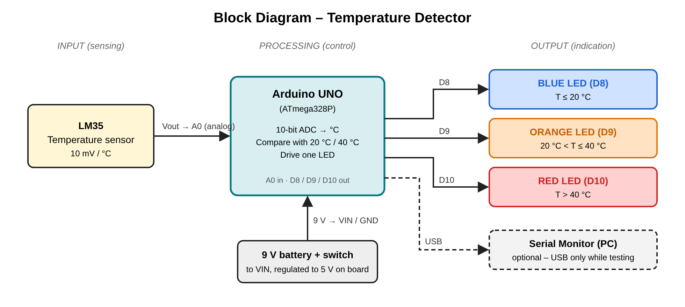
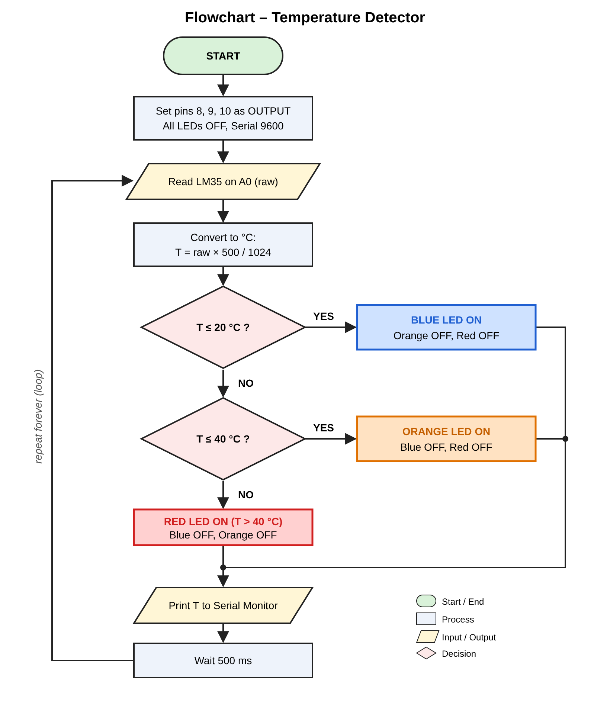
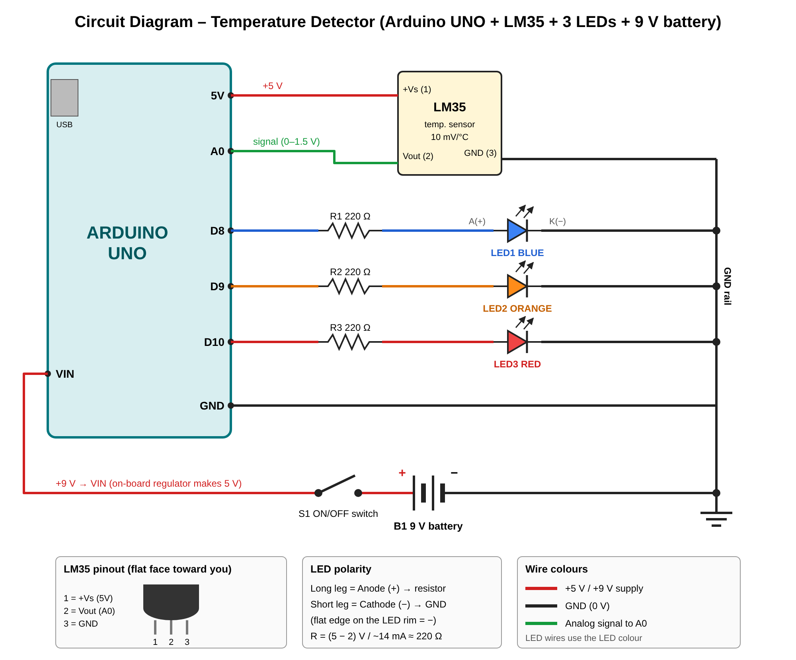

# Temperature Detector with 3 LED Indicators

**Course:** Electrical Engineering – Computer and Control for Algorithms

**Team:** Qays Ibrahim, Mosayab Aziz, Sarwar Haji, Lasf Waysi, Muhamed Ghazi, Hasan Ibrahim, Rzgar Farsat

**Supervisor:** Goran Wnis

An Arduino UNO reads the temperature from an **LM35** sensor and lights **one** LED:

| Temperature range      | LED ON     | Arduino pin |
|------------------------|------------|-------------|
| T ≤ 20 °C              | **Blue**   | D8          |
| 20 °C < T ≤ 40 °C      | **Orange** | D9          |
| T > 40 °C              | **Red**    | D10         |

Exactly 20 °C gives blue, and exactly 40 °C gives orange.

---

## 1. Diagram sketching

### Block diagram


The system has three parts:
- **Input:** the LM35 sensor turns temperature into a voltage (10 mV per °C).
- **Processing:** the Arduino converts that voltage to °C and compares it with 20 °C and 40 °C.
- **Output:** the Arduino turns on one of the three LEDs.
- **Power:** a 9 V battery feeds the Arduino's VIN pin through an on/off switch.

### Flowchart (algorithm)


**Algorithm in steps (pseudocode):**
```
START
  set D8, D9, D10 as outputs; turn all LEDs off
  LOOP forever:
      raw  ← analogRead(A0)            (average of 10 readings)
      T    ← raw × 500 / 1024          (°C)
      IF T ≤ 20        THEN Blue ON,   others OFF
      ELSE IF T ≤ 40   THEN Orange ON, others OFF
      ELSE                  Red ON,    others OFF
      print T to Serial Monitor
      wait 500 ms
```

---

## 2. Components sketching

### Circuit diagram


### Components list

| # | Component                          | Qty | Notes |
|---|------------------------------------|-----|-------|
| 1 | Arduino UNO (ATmega328P) + USB cable | 1 | Controller; USB is only needed to upload the code |
| 2 | LM35 temperature sensor (TO-92)    | 1 | 10 mV/°C, range −55…150 °C |
| 3 | Blue LED, 5 mm                     | 1 | T ≤ 20 °C |
| 4 | Orange LED, 5 mm                   | 1 | 20 < T ≤ 40 °C |
| 5 | Red LED, 5 mm                      | 1 | T > 40 °C |
| 6 | Resistor 220 Ω, ¼ W                | 3 | One in series with each LED (limits current) |
| 7 | Breadboard                         | 1 | |
| 8 | Jumper wires (male–male)           | ~10 | |
| 9 | 9 V battery (alkaline)             | 1 | Powers the circuit without a computer |
| 10 | 9 V battery snap connector with wire leads | 1 | Connects the battery to the circuit |
| 11 | Slide or toggle switch (SPST), small | 1 | Turns the detector on and off |

### Wiring table

| From                | To                         |
|---------------------|----------------------------|
| LM35 pin 1 (+Vs)    | Arduino **5V**             |
| LM35 pin 2 (Vout)   | Arduino **A0**             |
| LM35 pin 3 (GND)    | Arduino **GND**            |
| Arduino **D8**      | 220 Ω → Blue LED anode (+, long leg)   |
| Arduino **D9**      | 220 Ω → Orange LED anode (+, long leg) |
| Arduino **D10**     | 220 Ω → Red LED anode (+, long leg)    |
| All LED cathodes (−, short leg) | Arduino **GND** |
| Battery **+** (red lead) | Switch S1 → Arduino **VIN** |
| Battery **−** (black lead) | Arduino **GND** |

### Battery power

The detector runs from a **9 V battery** connected to the Arduino's **VIN** pin through an on/off switch. The Arduino's on-board regulator turns the 9 V into a steady 5 V. That 5 V powers the LM35 and the LEDs, so the code and the temperature formula stay exactly the same.

- **Why VIN and not 5V:** the VIN input goes through the regulator, which accepts 7–12 V. Never connect the 9 V battery to the **5V** pin, because that would damage the board.
- **Easier option:** a 9 V battery clip with a **2.1 mm barrel plug** plugs straight into the Arduino's round power jack and needs no wiring. It feeds the same regulator. Unplug it to turn the detector off.
- **How long it lasts:** the circuit draws about 50–60 mA (the board plus one LED). A typical 9 V alkaline battery (about 500 mAh) therefore runs it for roughly **8 hours**, which is enough for the demo and testing.
- **Weak battery:** below about 7 V the regulator can no longer hold 5 V, and the temperature readings start to drift. Replace the battery if the readings look wrong.
- **Uploading code:** connect the USB cable to upload. It is safe to have the battery and USB connected at the same time, because the board chooses the higher supply automatically.

**LM35 pins:** hold the sensor with the flat face toward you and the legs pointing down. From left to right the pins are 1 = +Vs, 2 = Vout, 3 = GND.

**Resistor value:** R = (5 V − ~2 V LED) / ~14 mA ≈ 220 Ω. This keeps the current well below the 20 mA limit of the LED and the Arduino pin.

---

## 3. Coding

The code is in [`code/temperature_detector/`](code/temperature_detector/):
- `temperature_detector.ino`: the main Arduino sketch (setup, loop, LED control)
- `temperature_logic.h`: the threshold logic and the ADC → °C conversion

**How the temperature is calculated:**
- The ADC is 10-bit with a 5 V reference, so one step = 5000 mV / 1024 ≈ 4.88 mV.
- The LM35 gives 10 mV per °C.
- So **T(°C) = raw × 500 / 1024**. For example, raw = 41 gives 20.0 °C and raw = 82 gives 40.0 °C.

**Core decision logic:**
```cpp
if (tempC <= 20.0)      → BLUE
else if (tempC <= 40.0) → ORANGE
else                    → RED
```

### How to upload
1. Open `code/temperature_detector/temperature_detector.ino` in the Arduino IDE. Both files must stay in the same folder.
2. Choose **Tools → Board → Arduino UNO** and choose the correct **Port**.
3. Click **Upload**.
4. Open **Tools → Serial Monitor** at **9600 baud** to see the temperature.
5. Unplug the USB cable, connect the 9 V battery and turn on the switch. The program starts by itself and keeps running from the battery. The Serial Monitor only works while USB is connected.

Example Serial Monitor output:
```
Temperature: 24.4 C  ->  ORANGE (20 C < T <= 40 C)
```

### How to test it
- **Room temperature (~22–26 °C):** the orange LED is on.
- **Hold the sensor between your fingers:** the temperature goes up slowly. It stays orange, because skin is about 33 °C.
- **Hot air (hair dryer, carefully):** the reading goes above 40 °C and the red LED is on.
- **Ice cube in a plastic bag on the sensor:** the reading drops to 20 °C or below and the blue LED is on.

### Logic test on a PC (optional)
The threshold logic can be tested without the hardware:
```bash
g++ -std=c++11 -I code/temperature_detector test/test_logic.cpp -o test_logic && ./test_logic
```
This checks the boundary values (20.0 → Blue, 20.1 → Orange, 40.0 → Orange, 40.1 → Red).

---

## Project structure
```
code/temperature_detector/
    temperature_detector.ino   Arduino sketch
    temperature_logic.h        thresholds + conversion
diagrams/
    block_diagram.svg / .png
    flowchart.svg / .png
    circuit_diagram.svg / .png
test/
    test_logic.cpp             PC test of the logic
```
